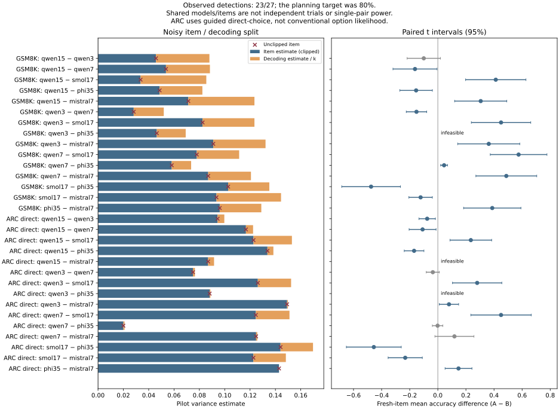
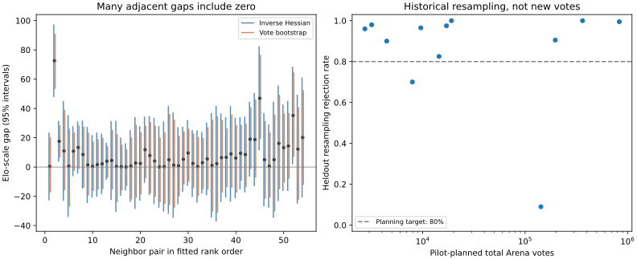

# eval-power

How many shared questions do I need to distinguish two models?

[Try my power calculator](https://mottopanikeiku.github.io/eval-power/) · [Prior work and citations](docs/PRIOR_WORK.md)

I generated **13,830 answers from six small language models** and detected differences in **23 of 27 planned comparisons** on fresh items. My repeated-decoding pilot found a larger decoding-noise share on GSM8K than on guided-choice ARC. These are detection frequencies, not proof of 80% power.

## Reproduce

I analyze the saved outputs without model downloads:

```bash
uv sync --locked
uv run python scripts/prospective_analysis.py
uv run python scripts/arena.py --bootstrap 500 --trials 200
uv run python scripts/check_results.py
uv run pytest
```

## What the experiment says

Each model answered the same 64 pilot questions per benchmark once greedily and five times at temperature 0.7. I used Qwen2.5 1.5B, 3B and 7B, SmolLM2 1.7B, Phi-3.5-mini and Mistral-7B-v0.3: six checkpoints across four families, with revisions and licenses in the [protocol](results/prospective/protocol.json). Qwen's 3B checkpoint has a noncommercial research license.

| Benchmark / decoding task | Median estimated decoding share at k=5 | Median questions for a hypothetical 1-point gap, k=1 → k=5 | Fresh detections |
|---|---:|---:|---:|
| GSM8K, free-form numeric answers | 33.2% | 20,147 → 8,743 | 13 / 14 |
| ARC-Challenge, guided direct choice | 4.6% | 11,371 → 10,864 | 10 / 13 |

I report [every pair, variance estimate, question count, p-value and interval](results/prospective/summary.json). The one-point counts assume a two-sided 5% test and an 80% normal-approximation target. I describe the variance calculation, pilot changes and collection costs in [the methods](docs/PRIOR_WORK.md#5-repeated-answers-and-preference-votes).



## Human preferences: adjacent ranks are usually unresolved

I also analyzed a [historical Arena vote release](data/arena_manifest.json). After an exposure filter, 54,985 votes cover 55 models. Only **4/54 adjacent contrasts** exclude zero under either pointwise Wald or bootstrap 95% intervals. Their median fitted 80%-power requirement is **3.30 million total network votes**, not direct-match votes.



For 12 score-independent planning pairs, 200 resamples each from disjoint held-out vote counts produced a median rejection fraction of 96.25%, ranging from 9% to 100%. I report [all pairs and assumptions](results/arena/summary.json).

## Limits

- The one-point budgets are hypothetical, not tested one-point effects. Here k=1 means one stochastic draw, not greedy decoding. Fewer questions with k=5 does not imply fewer generated answers or lower GPU cost.
- These are small instruction-tuned models on public benchmarks, so contamination is possible. A 64-question pilot can misestimate effects and variance components. I changed grading and ARC generation before confirmation; ARC uses guided direct choice, not conventional option-likelihood evaluation.
- Comparisons sharing a model reuse answers, with no multiplicity correction. I left plans above the 512-question collection limit unrun.
- Arena results are historical resamples, not newly collected votes or a current leaderboard. Its IID, transitive Bradley–Terry model cannot recover unavailable user/prompt clustering; adjacent intervals are neither simultaneous nor selection-adjusted.
- My [earlier single-answer analysis](results/calibration.csv) and calculator remain separate from the repeated-decoding experiment.

Written with AI coding assistance.
